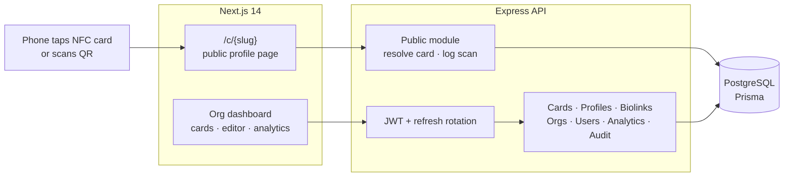
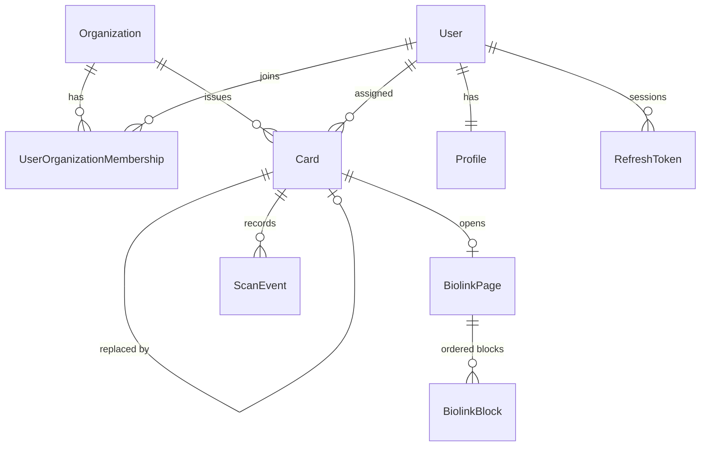

# NFC Digital Business Card Platform

**Case study.** A multi-tenant platform for NFC business cards and link-in-bio pages, built for the technology arm of a GCC holding group. Organisations issue tap-to-share cards to staff, design the profile page each card opens, and track every scan.

> This repository is a write-up, not the source. The code belongs to the client and stays private.
> I'm happy to give a live walkthrough of the architecture and code in an interview.

| | |
|---|---|
| **Role** | Sole engineer: architecture, backend, frontend |
| **Stack** | Next.js 14 (App Router) · React · TanStack Query · dnd-kit · Recharts · Node.js / Express · Zod · Prisma · PostgreSQL |
| **Size** | ~17k lines of TypeScript · 14-model schema · 9 backend modules |

---

## The problem

Paper business cards go out of date the day someone changes role. The client wanted to give every employee across its companies an **NFC card**. Tapping it on a phone opens a live profile with a one-tap "save contact" button. Each organisation needed to manage its own cards and staff, control branding, and see how cards were used.

## What I built

### Card lifecycle
- **Organisation-scoped card inventory.** Each card has the chip's UID (unique within its organisation) and a public URL slug (`/c/{slug}`) to write to the chip.
- **Bulk import** of card batches, then **assignment** to staff. Status goes *Unassigned → Active*, and cards can be disabled.
- **Lost-card replacement.** A new card links to the one it replaces and takes over the assignment. The old card is disabled at once, so a lost card can't keep sharing someone's details.

### Profiles and link pages
- **Block-based page editor** with 15 block types: avatar, heading, text, social links, buttons, email, phone, WhatsApp, location, video, image, embed and more. Blocks are reordered by drag-and-drop and shown in a live mobile preview.
- **Five link types** from one model: link-in-bio pages, short links, file links, vCards and event links.
- **vCard 3.0 generation**, so a visitor can save the full contact (work and personal numbers, socials, title, organisation) in one tap.
- **QR codes** generated for every card and link, for people without NFC.

### Privacy-conscious scan analytics
- Each scan records country, city, device type, OS, browser, referrer, language and UTM tags.
- **IP addresses are hashed before storage.** Unique-visitor counts work without keeping raw IPs.
- An organisation dashboard shows scans over time, unique visitors, the device mix and the top cards. Each link has its own stats page with country and device breakdowns.

### Multi-tenancy and access
- Organisations, memberships and roles, plus a platform super-admin layer above the tenants.
- JWT access tokens with **server-side refresh-token rotation and reuse detection.** If a revoked refresh token is ever presented, every session for that user is revoked, because that's the signature of a stolen token.
- An audit log written by the organisation, user, card, profile and link-page services.

---

## Architecture

### Data model (simplified)

---

## Engineering notes

- **The physical card and the person are kept separate.** The chip holds a slug, not a person. Reassigning or replacing a card is a database update, so nothing needs to be re-written to the chip, and a lost card can be cut off instantly.
- **The public scan path is resilient.** The public module only resolves `ACTIVE`, assigned cards. Anything else (unassigned, replaced, deleted) gets the same safe response, so the endpoint can't be used to enumerate cards.

---

*Built by [Fawas Koya](https://github.com/fawaskoya). Client details are anonymized.*
